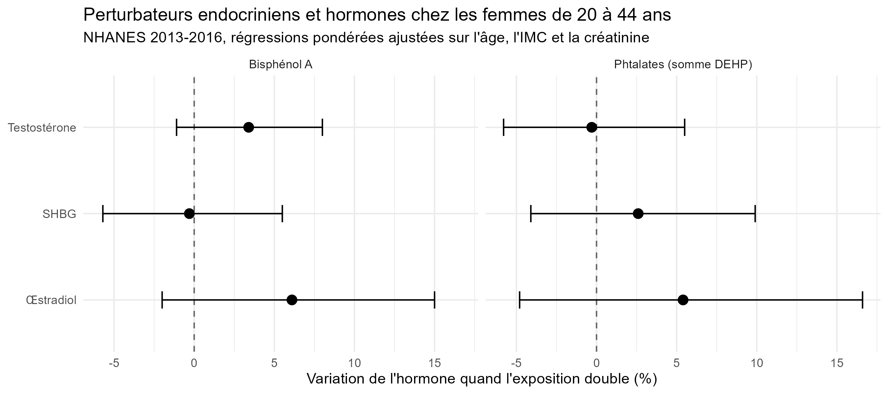

# 📌 Perturbateurs endocriniens et hormones sexuelles chez les femmes en âge de procréer (NHANES 2013-2016)

## Business Problem

Le bisphénol A et les phtalates sont présents dans de nombreux objets du quotidien : emballages alimentaires, plastiques souples, cosmétiques, parfums. Ce sont des **perturbateurs endocriniens** : ils peuvent interférer avec le fonctionnement des hormones.

Chez les femmes, un déséquilibre hormonal, et en particulier un excès d'androgènes (hormones dites « masculines »), est l'un des signes du **syndrome métabolique ovarien polyendocrinien (SMOP)**, l'ancien SOPK, renommé en mai 2026 par un consensus international publié dans *The Lancet*. Ce syndrome touche une part importante des femmes en âge de procréer et a des conséquences sur la fertilité et la santé métabolique.

Mieux comprendre si l'exposition à ces substances est associée à des modifications hormonales permet d'orienter la prévention et les recommandations de santé publique.

## Project Objective

**Question posée :**

> Les femmes de 20 à 44 ans plus exposées au bisphénol A et aux phtalates ont-elles des niveaux d'hormones sexuelles différents de celles qui y sont peu exposées ?

**Hormones étudiées :** testostérone, œstradiol, SHBG (la protéine qui transporte les hormones sexuelles dans le sang).

**Expositions étudiées :** bisphénol A (BPA) et somme des métabolites du DEHP, le phtalate le plus étudié pour ses effets anti-androgéniques.

NHANES ne contient pas de diagnostic de SMOP : l'analyse porte sur l'une de ses composantes, l'équilibre hormonal.

## About the Dataset

| Élément | Détail |
|---|---|
| **Source** | NHANES (National Health and Nutrition Examination Survey), CDC, données en accès libre |
| **Cycles** | 2013-2014 et 2015-2016, réunis pour augmenter l'effectif |
| **Fichiers utilisés** | Démographie (`DEMO`), hormones (`TST`), santé reproductive (`RHQ`), phtalates (`PHTHTE`), bisphénols et parabènes (`EPHPP`), PFAS (`PFAS`), créatinine urinaire (`ALB_CR`), mesures corporelles (`BMX`), tabac (`SMQ`), médicaments (`RXQ_RX`) |
| **Population finale** | 511 femmes de 20 à 44 ans |
| **Variables clés** | Concentrations urinaires de BPA et de 4 métabolites du DEHP, testostérone, œstradiol, SHBG, âge, IMC, créatinine, pondérations de l'enquête |
| **Limites** | Données transversales (une seule mesure), phase du cycle menstruel inconnue, exposition mesurée sur un seul prélèvement d'urine |

## Tools Used

- **R** : récupération des données (`nhanesA`), analyse pondérée (`survey`), graphiques (`ggplot2`)
- **PostgreSQL / pgAdmin** : stockage, jointures entre fichiers, sélection de la population, création des variables
- **RStudio** : connexion à la base et exécution des analyses

## Methodology

1. **Récupération des données** : téléchargement des fichiers NHANES depuis R, puis chargement dans PostgreSQL. Création d'une table dictionnaire (nom de chaque champ et sa description) pour documenter les variables.
2. **Sélection de la population (SQL)** : jointures des fichiers par l'identifiant de la participante, puis application des critères d'inclusion et d'exclusion (voir la méthodologie détaillée).
3. **Création des variables** : identification des femmes sous contraception hormonale à partir du fichier des médicaments, somme molaire des métabolites du DEHP.
4. **Analyse (R)** : régressions linéaires pondérées, tenant compte du plan de sondage de NHANES (poids, grappes, strates), ajustées sur l'âge, l'IMC et la créatinine urinaire. Hormones et expositions transformées en logarithme.
5. **Interprétation** : résultats exprimés en pourcentage de variation de l'hormone quand l'exposition double.

Le détail de la méthode, les choix effectués et leurs limites sont présentés dans [METHODOLOGIE.md](METHODOLOGIE.md).

## Key Findings

**Aucune association significative** n'a été observée entre l'exposition au bisphénol A ou aux phtalates du DEHP et les trois hormones étudiées.

| Hormone | Exposition | Variation quand l'exposition double | Intervalle de confiance à 95 % | p |
|---|---|---|---|---|
| Testostérone | Bisphénol A | +3,4 % | -1,1 % à +8,0 % | 0,134 |
| Testostérone | Phtalates (DEHP) | -0,3 % | -5,8 % à +5,5 % | 0,911 |
| Œstradiol | Bisphénol A | +6,1 % | -2,0 % à +15,0 % | 0,137 |
| Œstradiol | Phtalates (DEHP) | +5,4 % | -4,8 % à +16,6 % | 0,299 |
| SHBG | Bisphénol A | -0,3 % | -5,7 % à +5,5 % | 0,917 |
| SHBG | Phtalates (DEHP) | +2,6 % | -4,1 % à +9,9 % | 0,440 |

**Lecture :** toutes les fourchettes de confiance contiennent 0. Une tendance positive, non significative, apparaît entre le bisphénol A et la testostérone comme l'œstradiol.

**Ce que ce résultat veut dire :** ces données ne permettent pas de détecter de lien entre ces expositions et l'équilibre hormonal. Ce n'est pas la preuve d'une absence d'effet : la conception de l'enquête (une seule mesure, phase du cycle inconnue) limite fortement la capacité à détecter un effet modéré.

## Business Impact

- **Pour la santé publique** : ce type d'analyse, mené sur des données d'enquête nationales en accès libre, permet un premier repérage peu coûteux avant d'engager des études dédiées.
- **Pour la conception des études futures** : l'analyse montre que, sans information sur la phase du cycle et avec une seule mesure d'exposition, une enquête généraliste est mal adaptée pour étudier ces effets. C'est un argument pour investir dans des protocoles plus ciblés.
- **Pour la communication** : un résultat nul bien interprété évite de tirer des conclusions hâtives, dans un sens comme dans l'autre, sur un sujet sensible.

## Recommendations

1. **Mesurer la phase du cycle menstruel** au moment du prélèvement sanguin dans les études sur les hormones féminines.
2. **Répéter les prélèvements d'urine** pour mieux estimer l'exposition habituelle au BPA et aux phtalates, qui sont éliminés en quelques heures à quelques jours.
3. **Étudier des populations de femmes diagnostiquées** avec un SMOP, pour comparer directement leur exposition à celle de femmes non atteintes.

## Next Steps

- Ajouter d'autres expositions : parabènes (méthylparabène, mieux détecté que le butylparabène), PFAS.
- Calculer l'indice d'androgènes libres (testostérone / SHBG), plus proche de la définition clinique de l'hyperandrogénie.
- Étudier les expositions comme un mélange (méthodes dédiées aux mélanges de polluants).
- Comparer avec des données françaises de biosurveillance (étude Esteban).

---

*La partie statistique (choix des modèles, code R d'analyse et graphique) a été réalisée avec l'aide d'une IA. La formulation de la question, la sélection de la population et la préparation des données en SQL, ainsi que la vérification des résultats, sont personnelles.*

